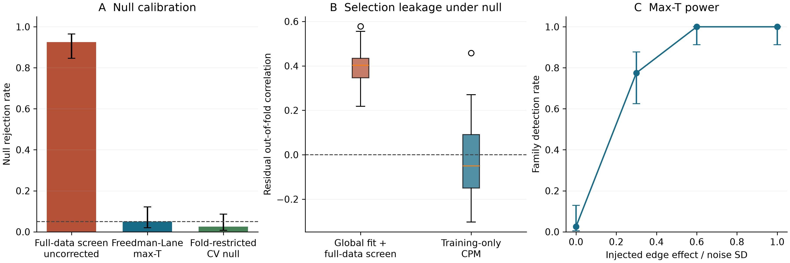

# nvperm

`nvperm` provides covariate-adjusted permutation tests and auditable out-of-fold prediction for connectome and vascular physiology research. It accepts numeric arrays rather than a particular imaging file format. Its small dependency set is NumPy and SciPy. Figures use an optional Matplotlib extra.

The package is an initial research software release. Its tests and synthetic benchmark provide evidence about the implemented algorithms under stated assumptions. They do not establish clinical validity or completed analysis of a real cohort.

## Installation

Install Python 3.10 or newer, clone or unpack this repository, and run the following commands from its root.

```sh
python -m venv .venv
. .venv/bin/activate
python -m pip install '.[test,plot]'
python -m pytest -v -p no:cacheprovider
```

For editable development, use `python -m pip install -e '.[test,plot]'`. The software has not yet been published to PyPI, so a bare `pip install nvperm` is not the installation route for this draft.

## Quickstart

```python
from nvperm import generate_cohort, freedman_lane, ConnectomePhysiologyCV

cohort = generate_cohort(120, 12, effect_size=0.6, random_state=42)
inference = freedman_lane(
    cohort.features, cohort.target, cohort.confounds,
    n_permutations=4999, random_state=42,
)
print(inference.pvalues_max_t, inference.qvalues)

cv = ConnectomePhysiologyCV(
    n_splits=5, alpha=10, model="partial_correlation", random_state=42
).fit(cohort.features, cohort.target, cohort.confounds)
print(cv.result_.mse_improvement)
print(cv.permutation_test(199, random_state=42).pvalue)
cohort.save("cohort.npz")
```

The tested exposure is a vector with one value per subject. Outcomes can be one vector or a subject-by-target matrix. Confounds can be a vector or a subject-by-covariate matrix. A constant intercept is always included. Rank-deficient nuisance columns are handled by an SVD basis. An exposure contained in the nuisance span is rejected because its adjusted effect is unidentified.

## Mathematical formulation

For an exposure x, nuisance design Z and outcome matrix Y, fit the reduced nuisance model and define its residual maker. The fitted nuisance component is restored before each permuted full-model fit.

\[
Y = Z\Gamma + x\beta + E,\qquad
R_Z=I-ZZ^+,\qquad
Y^{(b)}=ZZ^+Y+P_bR_ZY.
\]

The implementation projects the shuffled residuals through R_Z again and uses the Frisch-Waugh-Lovell coefficient for all targets in a batch. This gives the same coefficient and t statistic as fitting each full model explicitly, while sharing each permutation across the target family.

\[
x_r=R_Zx,\quad Y_r^{(b)}=R_ZP_bR_ZY,\quad
\widehat\beta^{(b)}=(x_r^Tx_r)^{-1}x_r^TY_r^{(b)}.
\]

The default statistic is the ordinary studentized t statistic with residual degrees of freedom equal to subject count minus nuisance rank minus one. `statistic="hc3"` uses a leverage-adjusted sandwich standard error. `statistic="partial_correlation"` uses nuisance-adjusted correlation. Studentization can improve comparability across edges; it cannot restore exchangeability under arbitrary variance differences.

Monte Carlo p values use the plus-one rule. Exact mode enumerates the complete declared permutation group including identity and divides the exceedance count by the group size. Exhaustive enumeration with estimated nuisance effects is generally an approximation to an exact finite-sample test. It is exact in special designs, including an intercept-only exchangeable null. Exact mode raises an error if the group exceeds `max_exact` rather than silently changing the analysis.

Westfall-Young single-step max-T compares each observed oriented statistic against the maximum across targets for each shared permutation. Strong familywise control requires subset invariance of the joint null distribution, commonly called subset pivotality. BH adjusted probabilities target the false discovery rate under independence or suitable positive dependence. Neither procedure promises validity for every dependence structure.

At B Monte Carlo draws the smallest probability is 1/(B+1). For sparse BH discoveries among m targets, plan enough draws to resolve the threshold 0.05/m. The short benchmark uses max-T because 199 draws cannot resolve an isolated BH discovery among 66 edges.

## Bootstrap intervals

Use `bootstrap_effects(y, x, covariates, blocks=site)` for pointwise percentile intervals on the same adjusted coefficients as Freedman-Lane. It resamples complete participant rows with replacement and preserves the number of rows in each stratum. Strata are not dependent clusters. The result reports both requested and estimable resample counts. If some designs are not estimable, it warns that the interval conditions on the retained draws.

Use `wild_bootstrap_effects(y, x, covariates)` as a fixed-design sensitivity check when error variance may differ across independent participants. It applies a shared random sign to each participant's leverage-adjusted residuals and returns pointwise basic intervals. Neither method computes a p value, a simultaneous interval or a cluster bootstrap.

## Cross-validation and permutation boundaries

Every outer fold fits confound normalization, feature nuisance coefficients, target nuisance coefficients, feature scaling and regression weights on its training subjects. Test rows are only transformed and scored. `fold_audits_` exposes the stored training state. Tests change held-out targets, features and confounds and prove that the corresponding training weights stay identical.

Nuisance regression uses one explicit SVD cutoff of machine precision times the larger training-design dimension times its largest singular value. The retained orthonormal basis controls training projections, reported nuisance rank and screening degrees of freedom. Held-out transformations and null refits use those same retained directions. Fold audits also expose the basis, coefficient map and absolute cutoff.

Ridge uses a fixed positive alpha and a dual solve when the edge count exceeds the training subject count. The partial-correlation model screens edges inside each training fold, constructs positive and negative edge sums, and fits ridge to those sums. It follows the structure of connectome predictive modeling while adding explicit nuisance and fold boundaries. Use `alpha_grid=(0.5, 2.0, 10.0)` and `inner_splits=3` to select a penalty by pooled inner validation MSE, with the smallest penalty breaking an exact tie. Each inner split refits preprocessing and any edge selection using its training rows only. An outer fold audit records `selected_alpha` and `inner_scores`. The default `alpha_grid=None` still uses fixed `alpha`.

Prediction includes a demographics/confounds baseline. Report the baseline MSE, full-model MSE and their difference. A large raw prediction correlation can come entirely from age or site. Residual prediction correlation is also available.

`permutation_test` uses reduced nuisance fits from each training set and restricts permutations to the intersection of outer-fold and declared exchangeability labels. It refits the target nuisance model, edge selection and regression for every null draw. If an alpha grid is supplied, it also retunes the penalty using the same inner splits and the resampled training targets. Training and held-out targets never cross during a shuffle. The score is baseline MSE minus full-model MSE. This conditional procedure inherits the approximate nature and exchangeability assumptions of residual permutation inference.

For family or repeated-measure data, `groups` keeps units together in outer and inner CV splits. The permutation engine supports shuffles within declared blocks, not whole-block exchanges. Grouped folds do not by themselves justify a permutation or bootstrap. Choose blocks using the study design. A singleton cell admits no nontrivial shuffle.

## Coupling features

`network_features` accepts `(subjects, ROIs, ROIs)` correlation matrices or their upper triangles in `numpy.triu_indices(n_rois, 1)` order. It reports within-network and between-network means, segregation (within minus between divided by within), and between-network integration. Diagonals are ignored. Negative correlations are zeroed by default and can be retained explicitly. Zero within-network means are accompanied by a false segregation validity flag.

`pulse_pressure` returns systolic minus diastolic pressure in mmHg. `rmssd` computes successive accepted NN-interval differences and returns milliseconds. It requires prior artifact review and performs no ECG peak detection. `neurovascular_features` appends physiology and raw segregation interactions without fitting a cohort-wide scaler. `motion_sensitivity` compares adjusted correlations before and after FD control and can run both corresponding permutation tests. Attenuation describes sensitivity to an added confound; it is not causal evidence.

When predicting pulse pressure, exclude `pulse_pressure_mmhg` and all `_x_pulse_pressure` columns from `neurovascular_features`. When predicting RMSSD, exclude `rmssd_ms` and all `_x_rmssd` columns. Remove every predictor derived from the outcome before CV. Training-only preprocessing cannot repair a predictor that contains the target.

## Plots and tutorial

Install `.[plot]` to use the Matplotlib helpers. `plot_adjusted_effects` marks max-T and BH results in a forest or volcano view and can show pointwise intervals in the forest view. `plot_cv_predictions` compares nuisance-only and full out-of-fold predictions against the observed target. Both return an axes object without showing or saving the figure.

Run `python examples/neurovascular_workflow_tutorial.py` for a synthetic worked example from coupling features through inference, nested CV and motion sensitivity. Add `--output-dir figures` to write the two plots.

## CLI

```sh
nvperm validate --input cohort.npz --output validation.json
nvperm run --input cohort.npz --output inference.json --csv edges.csv \
  --permutations 4999 --cv-permutations 199 --folds 5 --seed 42
nvperm benchmark --output benchmark.json --csv null_replicates.csv \
  --figure calibration.png --replicates 80 --permutations 199
```

The NPZ requires `features`, `target`, and `confounds` numeric arrays. For no confounds, supply an empty array of shape `(subjects, 0)`. Optional arrays are `fold_ids`, `blocks` and `groups`. Each must be a one-dimensional vector with one finite, non-missing label per subject. Nonempty string labels are supported. Supplied folds must contain at least two nonempty folds and keep each independent group intact. Each training fold needs at least four subjects. `validate --folds` and `--seed` mirror the corresponding run options when folds are generated. Pickled objects, NPY arrays and corrupt or empty archives are rejected. Validation checks dimensions, finite values and label compatibility; scientific QC, category encoding, missing-data handling and consent remain study responsibilities. Site indicators should use declared reference categories. This package does not infer site categories from participant identifiers.

JSON outputs include the schema version, seed, adjusted inference, predictions, fold labels and null scores. CSV exports contain one row per target with coefficient, statistic, raw p, max-T p and BH q. Errors exit with code 2. Omitting `--output` writes JSON to standard output.

## Benchmarks

Run `python examples/benchmark_neurovascular_cohort.py` to regenerate the saved JSON, CSV and figure. The fixed experiment uses 80 null cohorts, 90 subjects, 66 edges, 199 inference permutations and 49 CV permutations. Shared age and motion effects are strong; reduced-model errors are homoskedastic. The figure includes Wilson 95% intervals for rejection rates and power.

The intentionally invalid comparison residualizes using all subjects, screens edges using all targets, reports the selected edge's uncorrected p value and uses the full-data selection in CV. This evaluates an explicit leakage mechanism. It does not claim that global residualization alone must always inflate false positives.

Measured null rejection was 74/80 for the invalid selected-edge test, 4/80 for Freedman-Lane max-T and 2/80 for the fold-restricted CV null. Mean residual out-of-fold correlation was 0.395 for the invalid screen and -0.023 for training-only CPM. The saved report contains every replicate, uncertainty interval, seed and elapsed time. These small simulations are evidence under one design and do not establish uniform calibration for all cohorts.



## Research use and scope

MPI-LEMON, available as OpenNeuro `ds000221`, provides a concrete intended workflow involving brain connectivity, age, motion and peripheral physiology. Users must verify participant joins, modality availability, timing and ECG quality before analysis. This standalone release runs synthetic cohorts and has not recomputed a real MPI-LEMON result. The manuscript separates the documented dataset opportunity from measured package performance.

The package does not supply fMRI preprocessing, parcellation, causal mediation, automatic ECG QC, a general multi-regressor contrast system, heteroskedasticity-proof inference or clinical decisions. NumPy arrays allow it to complement imaging and statistical toolkits. See `paper/paper.md` for the JOSS manuscript and `CONTRIBUTING.md` for development and review expectations.

