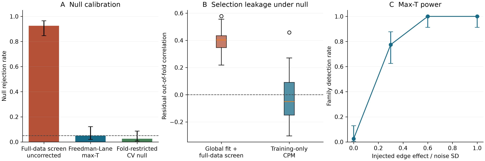

# Summary

`nvperm` is a Python library and command-line application for covariate-adjusted permutation inference and cross-validated connectome prediction. It combines a rank-aware Freedman-Lane engine, shared-permutation max-T correction, Benjamini-Hochberg adjustment, training-only nuisance regression, signed-network predictive modeling, and network/physiology feature extraction. Numeric arrays provide a reusable interface across parcellations, cohorts and physiological outcomes. NumPy and SciPy are the runtime dependencies; Matplotlib is optional for benchmark figures.

# Statement of need

Neurovascular studies often relate many connectivity edges to blood pressure or heart-rate variability while controlling age, sex, motion and site. Motion can generate systematic connectivity artifacts [@power2012], and a demographic association may dominate prediction without useful incremental connectivity information. Statistical validity depends on retaining the nuisance structure during permutation and fitting preprocessing within training folds. Implementing each operation separately leaves several opportunities for leakage and mismatched null distributions.

`nvperm` makes these boundaries explicit in a shared API. It returns adjusted probabilities, out-of-fold predictions, a confounds-only baseline, null scores and stored fold training state. Researchers can evaluate adjusted associations and incremental prediction separately. The contribution is reusable orchestration with transparent assumptions and numerical references.

# State of the field

Nilearn supplies broad neuroimaging representations, machine-learning workflows and mass-univariate inference; its neuroimaging ecosystem predates this package [@abraham2014]. Pingouin provides convenient statistical tests including partial correlations [@vallat2018]. BrainSpace focuses on macroscale gradients and connectome analysis [@vosdewael2020]. SciPy supplies general numerical methods and `scipy.stats.permutation_test`, whose user-defined statistic can encode many resampling problems [@virtanen2020]. Existing libraries can implement parts of this workflow. Nilearn also supplies neuroimaging permutation methods.

`nvperm` complements these packages with a compact array-based interface connecting shared edgewise nuisance-residual permutations, auditable training-only connectome prediction and a matching fold-restricted residual null. It does not replace image preprocessing, gradient analysis or a general statistical library. Its signed-network predictor follows the connectome predictive modeling framework [@shen2017], with explicit nuisance handling and fixed outer-fold boundaries.

# Software design

`freedman_lane.py` forms an orthonormal nuisance basis by SVD, tolerates redundant nuisance columns and rejects an unidentified tested regressor. For reduced-model residual maker R_Z and permutation P, it evaluates R_Z P R_Z Y, which equals the residualized restored-nuisance pseudo-outcome used by Freedman-Lane [@freedman1983; @winkler2014]. Reprojecting after permutation is essential. A batched Frisch-Waugh-Lovell calculation yields coefficients and ordinary or HC3 studentized statistics across all targets. Every target shares the same permutation row. Single-step max-T adjusts the family; BH returns false-discovery-rate adjusted probabilities [@benjamini1995].

Exact mode enumerates the declared within-block permutation group, including identity. Monte Carlo mode accepts an integer seed or NumPy Generator and applies the plus-one probability rule. Exhaustive enumeration is not generally a finite-sample exact test when nuisance effects are estimated. HC3 does not make arbitrary heteroskedastic errors exchangeable. Strong max-T control requires suitable joint-null invariance, and ordinary BH requires independence or appropriate positive dependence.

`cv_connectome.py` fits confound normalization, nuisance regression of features and targets, feature scaling, edge selection and ridge weights within each training set. One SVD cutoff defines the retained nuisance basis for rank, projection, held-out prediction and screening degrees of freedom. The held-out set receives fitted transformations and predictions. Ridge uses a dual solve for high-dimensional features. A partial-correlation model screens training residual associations and fits two signed-network sums. Fixed folds are reused by a null that shuffles residuals only within outer-fold and exchangeability cells and refits target-dependent steps. Grouped splitting is available; whole-block permutation and nested tuning are outside the current API.

`coupling.py` extracts segregation, integration, pulse pressure, RMSSD and descriptive FD sensitivity. It accepts matrices or upper triangles, excludes diagonals and marks undefined segregation. Raw interactions require no cohort-fitted scaler. Exclude a predicted physiology outcome and every interaction derived from it. `synthetic.py` generates controlled Fisher-z edge effects, age/motion confounding, configurable heteroskedasticity and positive semidefinite correlation matrices. Known linear coefficients apply to edge targets before nonlinear matrix projection. `cli.py` validates pickle-free NPZ input, subject labels and fold/group compatibility and writes structured JSON and CSV.

The deterministic tests compare statistics against explicit full-model fits, check nuisance orthogonality and singular designs, assess null rejection against predeclared binomial bounds, verify shared-target correction, and exercise CLI round trips. Held-out mutation tests prove that changing test targets, confounds or features leaves the corresponding training state unchanged, including null training weights.

# Research impact statement

MPI-LEMON includes MRI, cognition and peripheral physiology in younger and older adults [@babayan2019]; OpenNeuro `ds000221` provides a concrete intended setting. A connectome/pulse-pressure or HRV analysis must check subject correspondence, recording availability, temporal alignment and ECG quality. This standalone release has not rerun participant-level MPI-LEMON analyses. The documented dataset establishes a research use case, while measured software utility is currently demonstrated through synthetic cohorts and reproducibility tests. External adoption and sustained public development remain future evidence requirements.

The saved benchmark uses 80 null cohorts with 90 subjects and 66 edges, strong age/motion confounding, 199 inference permutations and 49 CV permutations. A deliberately invalid global nuisance fit plus full-data edge screen rejects 74/80 null cohorts; max-T rejects 4/80 and the fold-restricted CV null rejects 2/80. Mean residual out-of-fold correlation is 0.395 for the invalid screen and -0.023 for training-only CPM. The comparison includes selection leakage and does not attribute all inflation to nuisance residualization. Wilson intervals and individual replicates accompany the figure. The experiment supports one design-specific calibration claim and cannot establish uniform validity.

# AI usage disclosure

Codex using GPT-6.1 Sol assisted with software scaffolding, implementation, test generation, benchmark scripting, documentation and manuscript drafting. The human task brief specified the scientific problem, core modules, fold boundaries, inferential controls and deliverables. Automated validation compared generated algorithms against numerical references and ran the reproducibility suite. Full human review, editing, statistical validation and confirmation of ownership are pending for this local draft. Before submission, the human author must review and validate every assisted output, confirm the core design decisions and update this disclosure to document that completed review. All author conversations with JOSS editors and reviewers will be written by the human author, following the JOSS AI usage policy.

